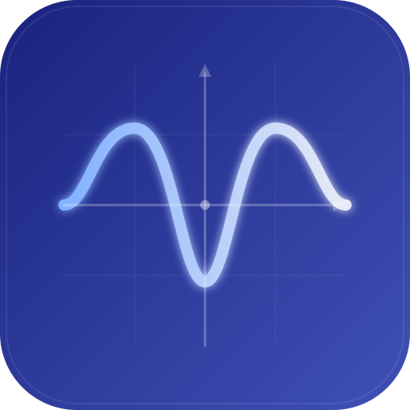
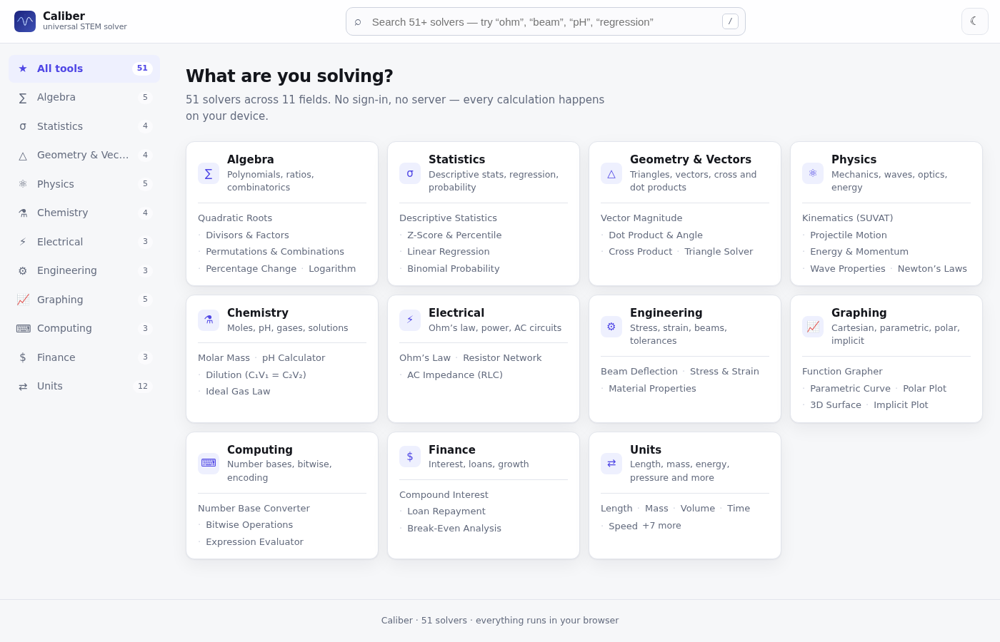
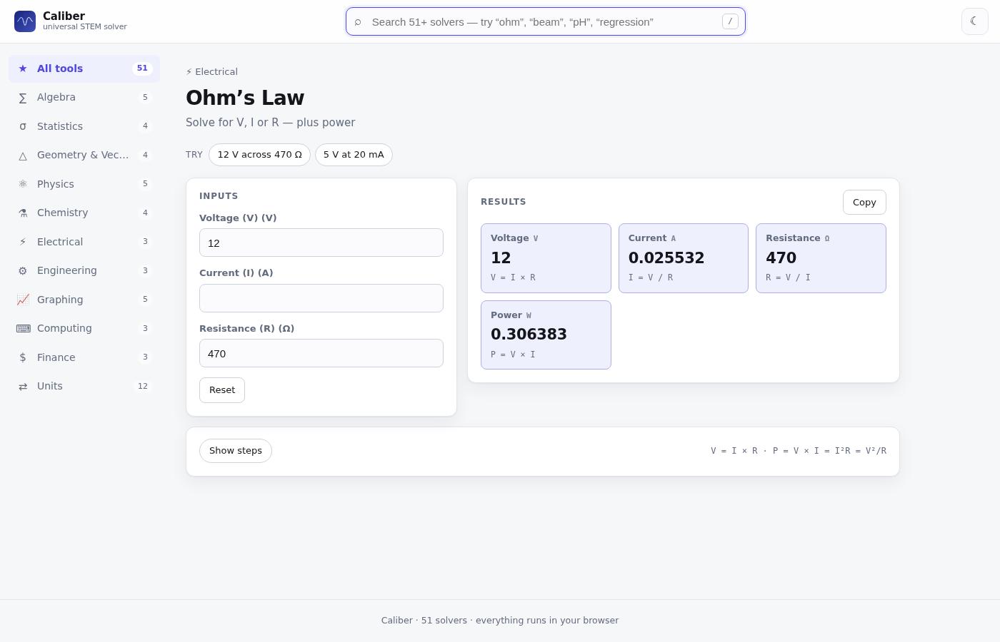
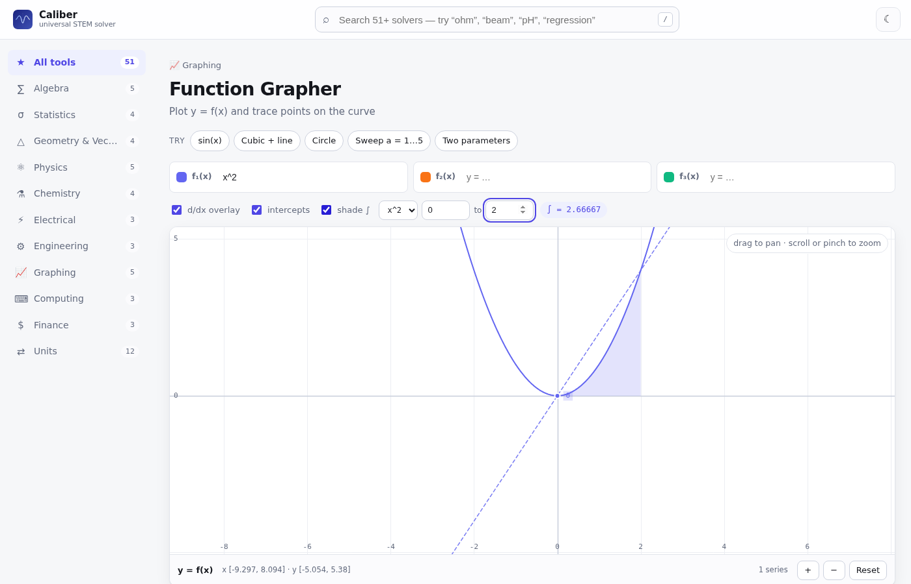
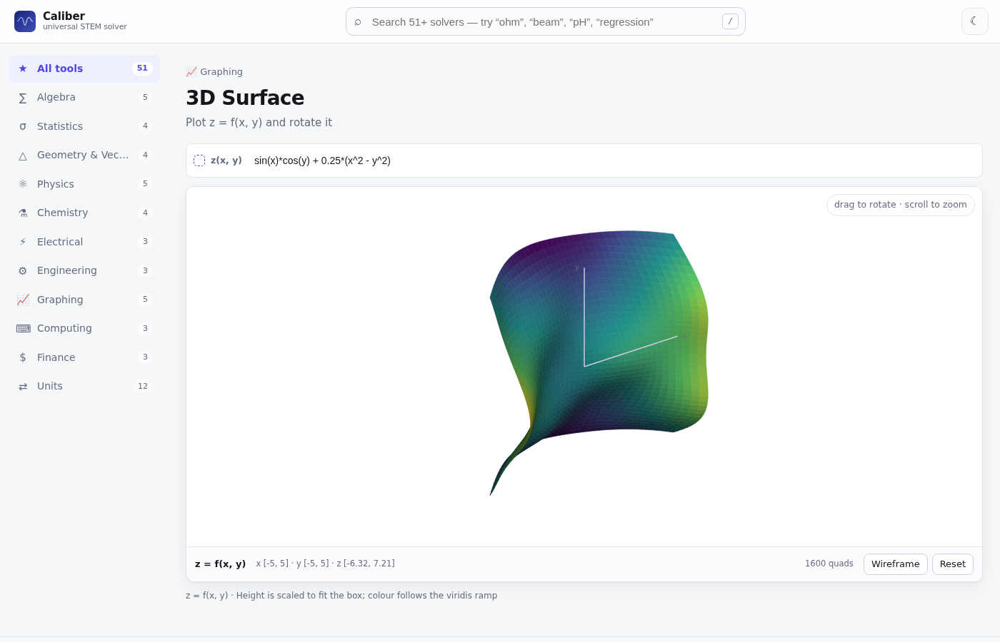
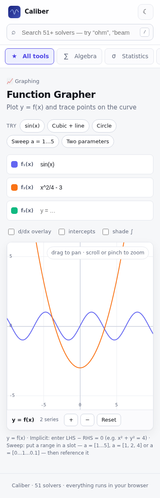

<p align="center">
  
</p>

# Caliber

**The universal STEM solver.** Fifty-one calculators for physics, chemistry,
electrical and mechanical engineering, statistics, geometry, finance and
units — running entirely in your browser. No account, no backend, no network
calls, no install.

**[Open Caliber →](https://velo4705.github.io/caliber/)**

| | |
|---|---|
|  |  |
|  |  |

---

## What it does

| Category | Count | Examples |
|---|---|---|
| Algebra | 5 | Quadratic roots, divisors, nCr/nPr, percentage change, logarithms |
| Statistics | 4 | Descriptive statistics, z-score, linear regression, binomial |
| Geometry & Vectors | 4 | Magnitude, dot & cross product, triangle solver |
| Physics | 5 | SUVAT, projectile motion, energy & momentum, waves, Newton's laws |
| Chemistry | 4 | Molar mass, pH, dilution, ideal gas law |
| Electrical | 3 | Ohm's law, resistor networks, AC RLC impedance |
| Engineering | 3 | Beam deflection, stress & strain, material properties |
| Computing | 3 | Number bases, bitwise operations, expression evaluator |
| Finance | 3 | Compound interest, loan repayment, break-even analysis |
| Units | 12 | Length, mass, volume, time, speed, energy, pressure, area, force, angle, data, temperature |
| Graphing | 5 | Cartesian, parametric, polar, implicit, 3D surface |

### Solve for the unknown

Most solvers accept any sufficient subset of terms and derive the rest, so you
never have to remember which arrangement the formula wanted:

```
#/t/ohm?V=12&R=470          →  I = 0.0255 A,  P = 0.306 W
#/t/ideal-gas?v=5&n=2&t=300 →  P = 9.85 atm
#/t/kinematics?u=0&a=9.81&t=3 →  v = 29.4 m/s,  s = 44.1 m
```

Values live in the URL, so **every calculation is a shareable link**.

### Graphing

Five plot modes, all evaluated through the same expression engine:

- **Cartesian** — `y = f(x)`, with automatic breaks at asymptotes
- **Parametric** — `(x(t), y(t))`
- **Polar** — `r = f(θ)`
- **Implicit** — `g(x, y) = 0`, via marching squares
- **3D surface** — `z = f(x, y)`, drawn by hand on canvas, no chart library

On top of the curves: parameter sweeps (`a = [1...5]`), derivative overlays,
integral shading that reports the value, labelled axis intercepts, and hover
tracing. Pan, scroll-zoom and pinch-zoom all work.



The layout is responsive throughout — the category rail becomes a scrolling
chip row on narrow screens, inputs stack above results, and the graph canvas
is sized for touch.

### Its own expression engine

Caliber ships a recursive-descent parser — a TypeScript port of the original
C++ engine — so expressions evaluate instantly and offline:

```
2^3^2      →  512        (right associative)
-2^2       →  -4         (unary binds looser than power)
2(3+4)     →  14         (implicit multiplication)
sin(30)    →  0.5        (in degrees)
gcd(12,18) →  6
10!        →  3628800
```

Forty-plus functions, the constants `pi`, `e`, `tau` and `phi`, factorial via
Lanczos gamma, and DEG/RAD/GRAD modes. Expressions compile to an AST once and
evaluate many times, so plotting 1400 samples costs one parse, not 1400.

---

## Why it's built this way

Most calculator apps hardwire every tool into the UI. In Caliber, **a solver is
data, not a component**. Each tool is a plain object:

```ts
export const ohm: Tool = {
  id: 'ohm',
  category: 'electrical',
  name: "Ohm's Law",
  keywords: ['ohm', 'resistance', 'voltage', 'current'],
  inputs:  [{ key: 'V', label: 'Voltage', unit: 'V' }, /* … */],
  outputs: [{ key: 'I', label: 'Current', unit: 'A', formula: 'I = V / R' }],
  compute: (v) => ({ V: derive(v.V, v.I * v.R), I: derive(v.I, v.V / v.R) }),
  reference: ['V = I × R', 'P = V × I = I²R = V²/R'],
}
```

The sidebar, search, category grouping, shareable URLs and the copy action are
all *derived* from that registry. **Adding a solver means adding one file** —
nothing else in the codebase needs to know it exists.

That is the difference between a codebase that grows and one that calcifies.
The previous version of this project was a desktop app where adding a mode
meant touching six build files and every tool was a bespoke widget class.

---

## Running it

Requires Node 22 or newer.

```bash
cd web
npm install
npm run dev          # dev server on http://localhost:5173
```

| Script | What it does |
|---|---|
| `npm run dev` | Dev server with hot reload |
| `npm run build` | Production build → `web/dist` |
| `npm run preview` | Serve the production build locally |
| `npm run typecheck` | `tsc --noEmit` |
| `npm run check` | Registry validation + maths test suite |
| `npm run verify` | Real-browser checks against a running server |
| `npm run bench` | Expression evaluator benchmark |
| `npm run serve:subpath` | Serve `dist/` under a `/caliber` prefix, as GitHub Pages does |

### Testing

Two layers, and both matter:

- **`npm run check`** — validates every registered tool (duplicate IDs, unknown
  categories, outputs `compute()` never returns, functions that throw) and runs
  142 assertions over the expression engine and the graphing maths. Headless,
  runs in CI.
- **`npm run verify`** — drives a real Chromium through Playwright: pages
  render, the canvas is actually painted, search and URL state work, and
  nothing reaches the console. It writes annotated screenshots to
  `web/screenshots/`.

  ```bash
  npm run dev            # in one terminal
  npm run verify         # in another
  ```

  **Look at the screenshots.** The first run of this suite caught five bugs
  the maths tests could not: duplicate React keys, every curve in a sweep
  sharing one colour, a false "unknown name" error, a control overlapping the
  axis labels, and a stale hardcoded tool count.

---

## Architecture

```
web/src/
├── registry/      types, categories, loader + validator
├── tools/         one file per category — every solver is data
├── lib/           expression engine, hash router, hooks, graph maths
└── components/    ToolView, SurfaceView, InputField, OutputGrid, CategoryRail
```

- **React is the only runtime dependency.** The expression parser, hash
  router, 2D grapher and 3D renderer are all hand-written.
- **Hash routing** means the app is a single static bundle with no server
  rewrite rules.
- **Every calculation is client-side.** Nothing is transmitted anywhere.
- **Strict TypeScript** — no `any`, no `@ts-ignore`, and unused code fails
  the build.

---

## Deploying

`base` is set to `'./'` in `vite.config.ts`, so `web/dist/` works on any static
host at any subpath, without path rewriting.

```bash
npm run build
# copy web/dist/ to GitHub Pages, Netlify, Cloudflare Pages, S3, anything
```

GitHub Pages is wired up by `.github/workflows/deploy.yml`, which builds `web/`
and publishes it on every push to `main`.

---

## Contributing

See [CONTRIBUTING.md](CONTRIBUTING.md) — including how to add a solver, and
the two commands every change should pass.

## License

MIT — see [LICENSE](LICENSE).
